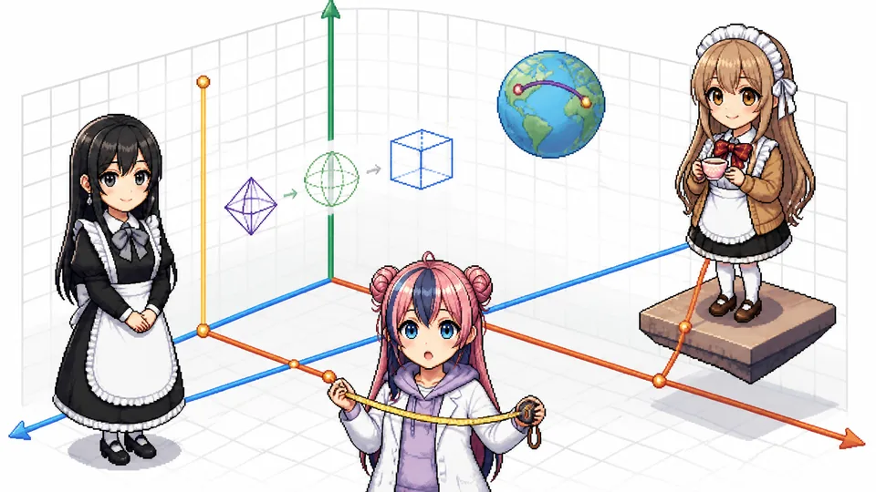

# 하루의 실험실 : 시아와 모아는 얼마나 멀까 (거리 척도 9가지)

**AHNBOAT LAB · 조수 하루의 3차원 실험실 · EP.04** — 랩타운 2층 실험 방의 실험대 (5, 0, 5): https://adminmrobo.github.io/ahn_boat_lab_town/haru3d.html

실험조수 하루가 시아와 모아 사이의 거리를 아홉 가지 자로 재고, 숫자와 그림으로 설명합니다. 두 편으로 나눴습니다.

- **1부 · 공간 속 거리** (공개): https://adminmrobo.github.io/Distance-metrics-tutorial/
- **2부 · 같은 것인가** (공개): https://adminmrobo.github.io/Distance-metrics-tutorial/part2/ — 해밍 · 자카드 · 쇠렌센-다이스 + AI 모델
- 연구실 홈: https://www.ahnboat.xyz/



## 1부에서 무엇을 하나

질문은 하나입니다. **시아와 모아는 얼마나 멀까?** 답은 자를 바꿀 때마다 달라집니다.

| 장면 | 자 | 데이터 | 값 |
|---|---|---|---:|
| 어디에 있나 | 유클리드 | 시아 (4, 0, 10), 모아 (12, 5, 7), Δ = (8, 5, −3) | **9.899** (= √98) |
| | 맨해튼 | 축을 따라 꺾어 걷기 | 16 |
| | 체비쇼프 | 가장 많이 움직인 축 | 8 |
| | 민코프스키 | p = 1.5 · 3 · 4 · 8 | 11.501 · 8.724 · 8.324 · 8.023 |
| 무엇을 말했나 | 코사인 | 하루 피규어 후기의 낱말 횟수 (표정, 도색, 배송): 시아 (2, 1, 0), 모아 (6, 2, 0) | **0.990** (각도 8.1°, 끝과 끝 유클리드 4.123) |
| 어디에 사나 | 하버사인 | 서울 (37.5665, 126.9780), 런던 (51.5072, −0.1276), 반지름 6,371 km | **8,857 km** (지구 속 직선 8,161 km) |

핵심 숫자는 **9.899 · 0.990 · 8,857 km**입니다. 같은 두 사람 사이라도 늘 체비쇼프 ≤ 유클리드 ≤ 맨해튼이고, 민코프스키 거리는 p를 키울수록 줄어 체비쇼프 8에 다가갑니다.

후기 여섯 개는 하루 연구실 가상 상품(하루 2등신 미니 피규어)의 예시 후기입니다. 코사인으로 재면 표정(시아·모아 0.990), 도색(초파리·박사 0.894), 배송(주판봇·X1 0.894) 세 묶음으로 모입니다.

## 페이지 구성 (1부: 10개 파트, 대사 35개)

1. 인트로: 답이 여섯 개 · 2. 곧게 재기: 유클리드 (3D) · 3. 다른 자: 맨해튼·체비쇼프 (3D) · 4. 자의 모양: 민코프스키 (3D, 거리가 1인 면) · 5. 무엇을 말했나: 코사인 (3D) · 6. 비슷한 후기 묶기 (3D + 코사인 행렬) · 7. 둥근 땅: 하버사인 (3D 지구본) · 8. 코드: 자마다 한 줄 · 9. 결과: 여섯 개의 답 · 10. 정리와 대가

3D 장면은 x(오른쪽, `#e4572e`)·y(위, `#2a9d6f`)·z(`#1f8fd6`) 오른손 좌표계 위에 캔버스로 직접 그립니다. 민코프스키 곡선과 '거리가 1인 면', 지구본 위 호는 같은 숫자로 페이지 안에서 계산합니다.

## 2부에서 무엇을 하나

질문은 **시아와 모아가 가져온 것이 같은 것인가?** 입니다.

| 장면 | 자 | 데이터 | 값 |
|---|---|---|---:|
| 쉬운 판 도장 | 해밍 | 박사 얼굴 도장(캐릭터 팩 박사 E13) → 흑백 32 × 32 = 1,024점. 모아 위작은 흰 앞머리 줄이 빠짐 | 시아 13점 · 모아 67점 |
| 어려운 판 도장 | 해밍 | 진품 인쇄 400장(누르는 힘·번짐·잉크 빠짐) vs 위작 400장(새김 1px 어긋남), 학습 600 · 시험 200 | 기준선 26점 → 정확도 **0.900** |
| | AI 모델 | 로지스틱 회귀(C = 0.5), 입력 = '더 묻은 점'·'빠진 점' 지도 2,048개 | 정확도 **1.000** (200장 중 200장) |
| | | 시아 진품 30점(해밍은 위작 판정) · 모아 위작 19점(해밍은 진품 판정) | 위작 확률 0.070 · 0.974 |
| | 학습 곡선 | 학습 장 수 2 · 4 · 8 · 16 · 600 | 0.695 · 0.820 · 0.850 · 1.000 · 1.000 |
| 피규어 | 자카드 · 다이스 | 하루 2등신 미니 피규어 블록 모형 24 × 24 × 24 (공식 1,204블록) | 모아 정품 0.996 · 0.998 / 시아 해적판 0.705 · **0.827** |

핵심 숫자는 **0.900 · 1.000 · 0.827**입니다. 피규어는 하루 연구실 가상 상품입니다.

## 폴더

| 경로 | 내용 |
|---|---|
| `index.html` | 1부 완성 페이지 (한 파일) |
| `part2/index.html` | 2부 완성 페이지 (한 파일) |
| `images/` | 표지(1부·2부), 홈 카드 썸네일 (WebP, 960px) |
| `data/distance_run.json` | 실험 기록 (1부·2부 공통): 위치 거리, 후기 벡터·코사인 행렬, 도장 인영, 피규어 블록 겹침, 지구 위 거리 |
| `data/haru_lines_part1.json` | 1부 하루 대사 [화면용, 읽기용] |
| `data/haru_exp_part1.json` | 1부 대사별 표정 키 |
| `data/haru_lines_part2.json` · `data/haru_exp_part2.json` | 2부 대사와 표정 키 (36개) |
| `data/sprites.json` | 하루 표정 7장(216px) + 시아·모아 얼굴(96px) |
| `tools/experiment.py` | 재현 코드 (numpy·Pillow·scikit-learn, 시드 4). 두 번 돌려도 같은 파일 |
| `tools/sprites.py` | 캐릭터 팩에서 그림 만들기 |
| `tools/page_template_part1.html` · `tools/scenes_part1.js` | 1부 페이지 틀과 장면 |
| `tools/page_template_part2.html` · `tools/scenes_part2.js` | 2부 페이지 틀과 장면 (도장 돋을새김, 다른 점 기둥, 해밍 분포, 가중치 기둥, 피규어 블록) |
| `tools/build_page.py` | 틀 + 데이터 → `index.html` |

다시 만들기 (저장소 맨 위 폴더, 옆에 `../fruitfly-lab-expressions`가 있을 때):

```bash
python3 tools/experiment.py     # data/distance_run.json
python3 tools/sprites.py        # data/sprites.json
python3 tools/build_page.py     # index.html, part2/index.html
```

## 출처

- 아이디어: 거리 척도 9가지(Euclidean, Cosine, Hamming, Manhattan, Minkowski, Chebyshev, Jaccard, Haversine, Sørensen–Dice)를 한 장에 모은 인포그래픽 'Distance metrics'(@mathemetica 표기). 원본 그림과 숫자는 쓰지 않았고, 시아·모아의 좌표·후기·도시를 새로 정해 다시 계산했습니다.
- 그림: [fruitfly-lab-expressions](https://adminmrobo.github.io/fruitfly-lab-expressions/) 캐릭터 팩. 하루 표정 E07 설명, E01 기쁨, E08 안내, E04 놀람, E09 생각, E12 응원, E10 확인, 시아·모아 E01 기쁨. 표지는 캐릭터 팩 원형을 바탕으로 만든 16비트 픽셀아트입니다.

Reon Ahn's Page © 2022 Reon Ahn · CC BY-NC 4.0
